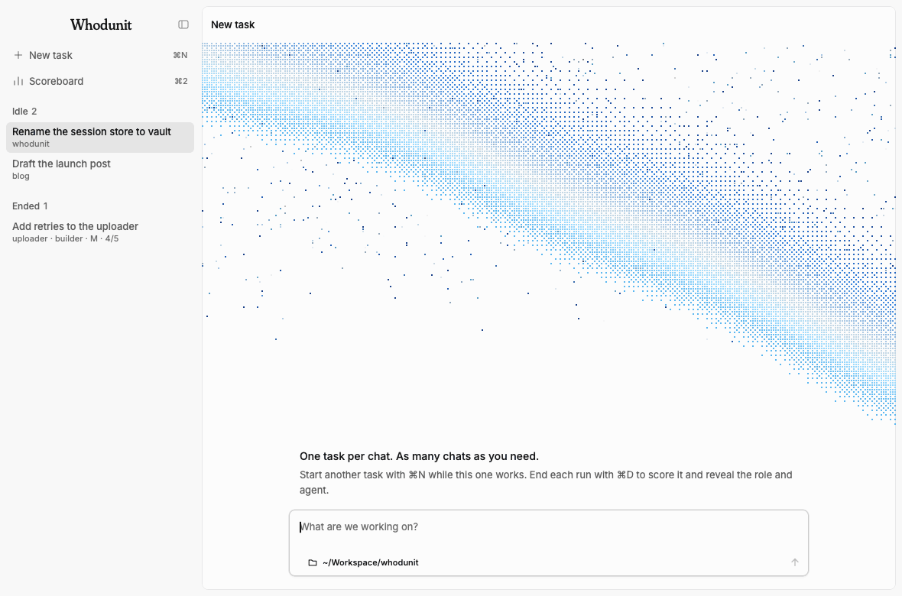

# whodunit

> [!NOTE]
> This experiment is completed! Check [RESULTS.md](RESULTS.md) to read more about it.

> The phrase "whodunit" is a grammatical abomination. Please use the proper term, a "who has done this".
>
> — Captain Raymond Holt

<picture>
  <source media="(prefers-color-scheme: dark)" srcset="docs/waves-dark.gif">
  
</picture>

## Why

The main gist is to hide the model until I rated it. Jev picks the role on a given criteria, and a deck picks the model for that role. Bend2 lays down the laws of how that plays out: how a deck deals, how a score turns into an outcome, and that nothing shows before the run ends. After a week or two of real tasks, I will know which agent actually earns each kind of job.

Though slightly scientific, and kinda knowing Opus 5.5 will beat most of the charts, I thought this is a solid playground to give other models a shot, as well as offering some space for the underdogs.

> [!IMPORTANT]
> **Ground rule: the UI never reveals the model, and not the role either, while a run is open.** Knowing either one biases how you judge the work. Both show up only once you end the run, and by then the session is sealed.

## How a run goes

This app uses [pi](https://github.com/earendil-works/pi) as the main harness and backend.

1. You send the first prompt of a new pi session.
2. [Jev](#the-classifier) reads it and picks a **role** (and a size: S, M or L). When it's less than 60% sure, you pick the role yourself with one key.
3. The extension deals the next model from that role's shuffled **deck**, so every contender gets an even share of runs and you can't predict the next one. The session sticks to that model.
4. While you work, pi's footer shows neither the role nor the model, only that `/done` ends the run.
5. **End the run** with `/done` when its task is finished. This scores and seals only that session; other chats keep working:
   - One card, one score, from 5 to 1:

     | Score | Means | Logged as |
     |---|---|---|
     | 5 | nailed it, great | nailed it |
     | 4 | nailed it, rough edges | nailed it |
     | 3 | needed small fixes | needed my fixes |
     | 2 | needed big fixes | needed my fixes |
     | 1 | failed | failed |

   - Cancelling the card goes back to working.
   - The session is then **sealed**: no more prompts, `/new` starts the next task.
   - Only now do you see the role, the size and the model, and the run lands in `runs.jsonl`.

Roles marked `fanout` (short one-shot jobs like research or prose) run every contender in parallel instead. You see their answers as A, B, C, pick the best, and the winner continues the session. The role stays hidden there too.

The app's keys, score card and fan-out picker are in [`app/README.md`](app/README.md).

## The classifier

Jev is TypeSafe's classifier model (`typesafe/jev-latest`). TypeSafe isn't one of the labs on trial, so the classifier has no stake in who wins. For every first prompt it answers two questions:

- **Role:** which of the roles below fits, judged against each role's `criteria`. Below 0.6 confidence (`classifier.minConfidence`), you pick the role, with Jev's guess listed first.
- **Size:** S (minutes), M (under an hour) or L (hours or more). It's logged for the scoreboard and never routes anything.

If Jev can't be reached, the run falls back to `builder`. `/role <name>` before the first prompt skips Jev. The scoreboard reports how often each of these decided the role.

The same first prompt also goes to a small model (`titler` in `roles.json`, Claude Haiku 5.5 by default) for a short session title. It sees only the prompt, never the dealt model, and `/name` overrides it.

## The contenders

From my `roles.json` for the first trial (2026-11-08 to 2026-11-11):

| Role | What lands here | Effort | Contenders |
|---|---|---|---|
| `errand-boy` | Chores under about 15 minutes: scaffolding, renames, shell or file work, brute-force repetition | medium | Opus 5.5, GPT-6.1 Sol, Kimi K3.1 Pro, Gemini 4 Argon |
| `builder` | The goal is clear and the job is writing code in a repo | high | Opus 5.5, GPT-6.1 Sol |
| `brainiac` | No clear path yet: diagnosing, architecture, nasty debugging, planning | xhigh | Opus 5.5, GPT-6 Astra |
| `scout` (fan-out) | Research or comparison that needs the web | high | Opus 5.5, GPT-6 Astra, Kimi K3.1 Pro |
| `scribe` (fan-out) | Prose: posts, docs, messages, copy | high | Opus 5.5, GPT-6 Astra, Gemini 4 Argon |

Model IDs: `anthropic/claude-opus-5-5`, `openai/gpt-6.1-sol`, `openai/gpt-6-astra`, `google/gemini-4-argon` and `fireworks/accounts/fireworks/models/kimi-k3p1-pro`. `extension/roles.example.json` is this same config.

## What's here

> [!IMPORTANT]
> This is a plain, simple-enough, rune app built on top of `pi`. It literally **does not work** if you don't have it installed. That said, **do not** install this on top of your current `pi` setup. That would be catastrophic. Rather, ask your agent to run a copy of `pi` dedicated to running this experiment. Also you don't even need the literal app to run this! You can just yoink the extension and the scoreboard if you hate my taste.

| Path | What it is |
|---|---|
| `extension/` | The pi extension: virtual model `whodunit/auto`, classifier, decks, fan-out, `/done` and `/role` |
| `app/` | An optional macOS desktop frontend in Rust, see [`app/README.md`](app/README.md) |
| `scoreboard/` | A standalone Node scoreboard that prints Markdown |
| `laws/` | The rules in [Bend2](https://github.com/bendlang/bend), with proofs, plus a check that the extension still follows them |

## Setup

**1. Link the extension and write your roles.**

```sh
ln -s "$PWD/extension" ~/.pi/agent/extensions/whodunit
mkdir -p ~/.pi/agent/whodunit
cp extension/roles.example.json ~/.pi/agent/whodunit/roles.json
```

Edit `roles.json` to fit your accounts. `agents` maps pi model IDs (`provider/id`) to display names. Each role has an `effort`, the `criteria` the classifier reads, its `contenders` and, optionally, `"fanout": true`. Every contender must be in pi's model catalog.

**2. Point pi at the router.** In `~/.pi/agent/settings.json`:

```json
"defaultProvider": "whodunit",
"defaultModel": "auto",
"enabledModels": ["whodunit/auto"]
```

**3. Keys.** The classifier in the example config is TypeSafe's Jev (`TYPESAFE_API_KEY`). Fan-out web search uses Exa's hosted MCP (`EXA_API_KEY`); without it, fan-outs run with no web search. Contenders use whatever sign-in pi already has for their providers.

**4. Optional: the app.** See [`app/README.md`](app/README.md#install).

## Using it

- One task per session, not one task at a time. In the app, start another chat with ⌘N while other chats keep working. Return to any open chat to continue its task.
- `/role <name>` forces a role before the first prompt. Once a run is dealt, `/role` only tells you the role after `/done`.
- `/done` on every run when you're finished with its task. Switching chats doesn't end or score a run; it stays open and shows on the scoreboard as unrated until you score it.
- Switching models by hand with `/model` ends nothing, but `/done` then logs the run as 1, *failed*, for the dealt agent, without asking.
- Don't open `/session` before `/done`, because it names the model.
- Prompts can carry images: paste or drop them in the app, or attach them as plain pi allows. Jev reads only the text and a note that images came with it; fan-out contenders all get the images. Contenders without vision see pi's placeholder, so keep image-heavy tasks in mind when you score.

## Scoreboard

```sh
node scoreboard/scoreboard.mjs --since 2026-11-09 [--until 2026-11-14]
```

A **Leaders** table comes first: who's winning each role, their mean score or fan-out record, and how far ahead of the runner-up they are. Then you get one table per role, with the leader in bold: runs, nailed %, mean score, median minutes you spent, cost per run and fan-out wins. Above the tables, and under each role, a line shows who decided the role: Jev, the picker, `/role` or the fallback. Normal roles rank by mean score, and fan-out roles by share of fan-outs won. Ties go to the cheaper agent, and rows with fewer than 3 runs are marked *too few*. Minutes and cost come from pi's session files, with idle gaps capped at 10 minutes. Cost is at list price, so metered and subscription models are compared on the same terms.

The app's Scoreboard page opens with one tile per role naming its leader, then shows the same numbers as one table per role, with a pixel sprite for each model and role.

## Laws

`laws/` holds the rules in [Bend2](https://github.com/bendlang/bend), a language with proofs checked by its compiler:

- `rules.bend`: the score-to-outcome mapping, what a switched run logs, what the UI may show of a deal, and how a deck deals.
- `LAWS.bend`: the claims. A 5 is nailed and a 1 failed. A higher score never gets a worse outcome. A switched run logs 1, failed. Nothing about a deal shows before the run ends. A deck deals its own head before it refills. A fresh deck deals its whole shuffle, each card once, then runs dry.
- `PROOF.bend`: the proofs.

```sh
node laws/check.mjs
```

The check runs the proofs, compiles `rules.bend` to JavaScript and compares it with `extension/rules.ts` on every score, a switched run and 2,000 random deals. It needs `bend` ([install](https://bend-lang.com)). The shuffle itself is random, so it stays outside the proofs: they show that a deck deals its shuffle fairly, not that the shuffle is fair.

## Data

Everything stays local, in `~/.pi/agent/whodunit/`:

- `roles.json`: your config
- `decks.json`: each role's remaining cards
- `runs.jsonl`: one line per deal, fan-out and ended run
- `app.json`: the app's settings

## License

MIT, see [LICENSE](LICENSE).
