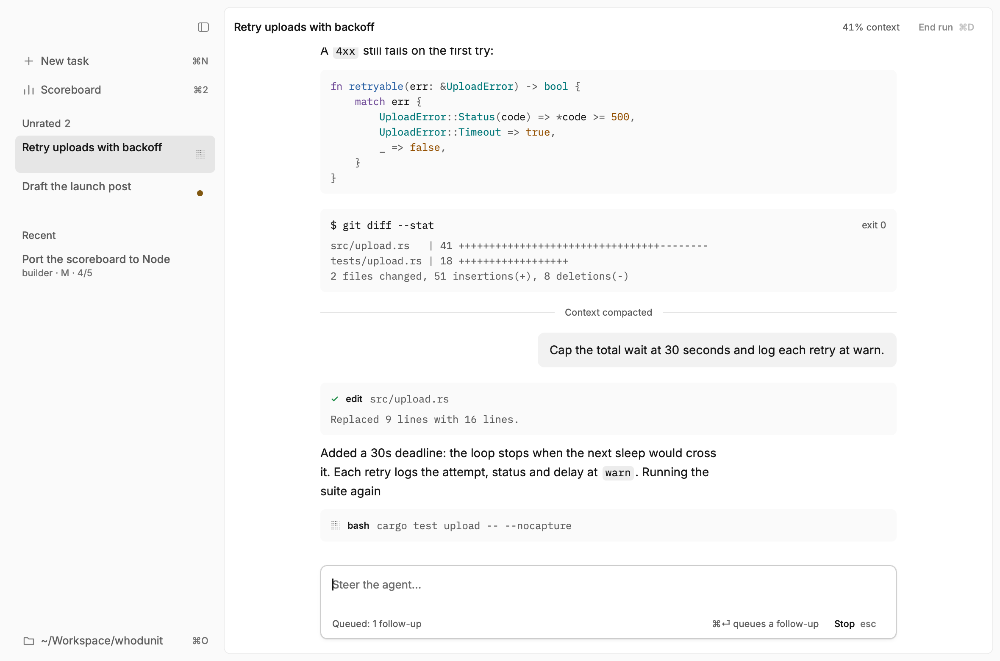
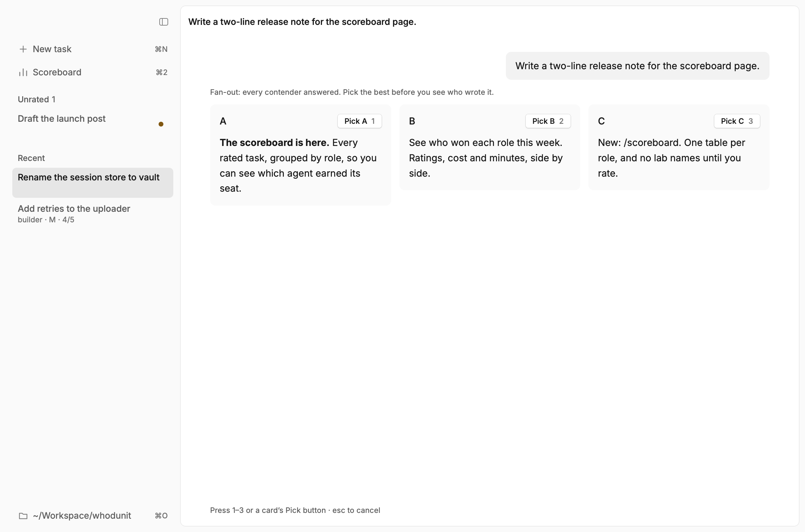

# whodunit

Blind trials for coding agents, run inside [pi](https://github.com/earendil-works/pi). Each task gets a hidden model, you score the run, and only then do you find out who did it.

<picture>
  <source media="(prefers-color-scheme: dark)" srcset="docs/run-dark.png">
  
</picture>

## Why

Everyone has a favourite lab, and it leaks into how you judge the work. whodunit hides the model until after you've rated it. After a week or two of real tasks, you know which agent actually earns each kind of job.

## How a run goes

1. You send the first prompt of a new pi session.
2. A classifier reads it and picks a **role** (and a size: S, M or L). When it isn't sure, you get a one-key role picker.
3. The extension deals the next model from that role's shuffled **deck**, so every contender gets an even share of runs and you can't predict the next one. The session sticks to that model.
4. pi's footer shows the role, never the model.
5. `/done` asks how it went (nailed it, needed my fixes, failed) and for a score from 1 to 5. Then it reveals the model and appends the run to `runs.jsonl`.

Roles marked `fanout` (short one-shot jobs like research or prose) run every contender in parallel instead. You see their answers as A, B, C, pick the best, and the winner continues the session.



## What's here

| Path | What it is |
|---|---|
| `extension/` | The pi extension: virtual model `whodunit/auto`, classifier, decks, fan-out, `/done` and `/role` |
| `app/` | A macOS desktop frontend in Rust (built on [rune](https://github.com/anomalyco/rune)). It drives pi over RPC and adds a sidebar of sessions, a rating guard and a scoreboard page |
| `scoreboard/` | A standalone Node scoreboard that prints Markdown |

You don't need the app. The extension works in plain pi.

## Setup

**1. Link the extension and write your roles.**

```sh
ln -s "$PWD/extension" ~/.pi/agent/extensions/whodunit
mkdir -p ~/.pi/agent/whodunit
cp extension/roles.example.json ~/.pi/agent/whodunit/roles.json
```

Edit `roles.json` to fit your accounts. `agents` maps pi model IDs (`provider/id`) to display names. Each role has an `effort`, the `criteria` the classifier reads, its `contenders` and, optionally, `"fanout": true`. Every contender must be in pi's model catalog.

**2. Point pi at the router.** In `~/.pi/agent/settings.json`:

```json
"defaultProvider": "whodunit",
"defaultModel": "auto",
"enabledModels": ["whodunit/auto"]
```

**3. Keys.** The classifier in the example config is TypeSafe's Jev (`TYPESAFE_API_KEY`). Fan-out web search uses Exa's hosted MCP (`EXA_API_KEY`); without it, fan-outs run with no web search. Contenders use whatever sign-in pi already has for their providers.

**4. Optional: the app.** It needs macOS and Rust (the version is pinned in `app/rust-toolchain.toml`).

```sh
cd app
scripts/bundle.sh    # installs ~/Applications/Whodunit.app
```

## Using it

- One task per session: `/new` between tasks.
- `/role` shows the current role, and `/role <name>` forces one before the first prompt.
- `/done` on every run. Switching models by hand with `/model` logs the run as *failed* for the dealt agent.
- Don't open `/session` before `/done`, because it names the model.

## Scoreboard

```sh
node scoreboard/scoreboard.mjs --since 2026-11-09 [--until 2026-11-14] [--no-reference]
```

You get one table per role: runs, nailed %, mean score, median minutes you spent, cost per run and fan-out wins. Normal roles rank by mean score, and fan-out roles by share of fan-outs won. Ties go to the cheaper agent, and rows with fewer than 3 runs are marked *too few*. Minutes and cost come from pi's session files, with idle gaps capped at 10 minutes. Cost is at list price, so metered and subscription models are compared on the same terms.

There's also a reference row computed from your last 30 days of Claude Code transcripts (`~/.claude/projects`). Pass `--no-reference` to leave it out. The app shows the same board on its Scoreboard page, or prints it with `whodunit -- --scoreboard`.

## Data

Everything stays local, in `~/.pi/agent/whodunit/`:

- `roles.json`: your config
- `decks.json`: each role's remaining cards
- `runs.jsonl`: one line per rated run
- `app.json`: the app's settings

Session transcripts stay where pi keeps them.

## License

MIT, see [LICENSE](LICENSE).
