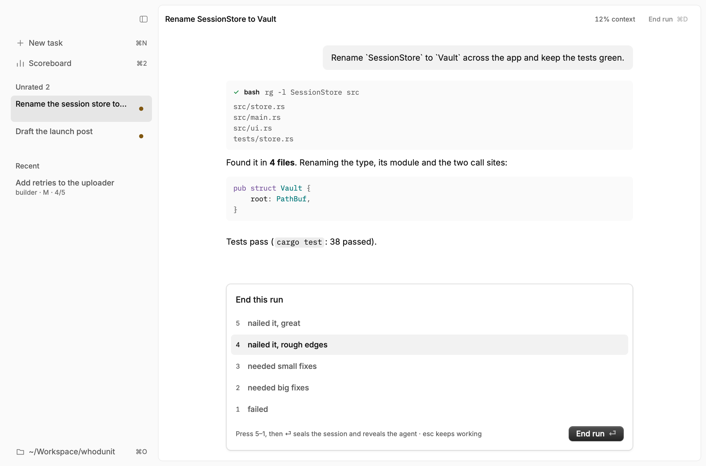
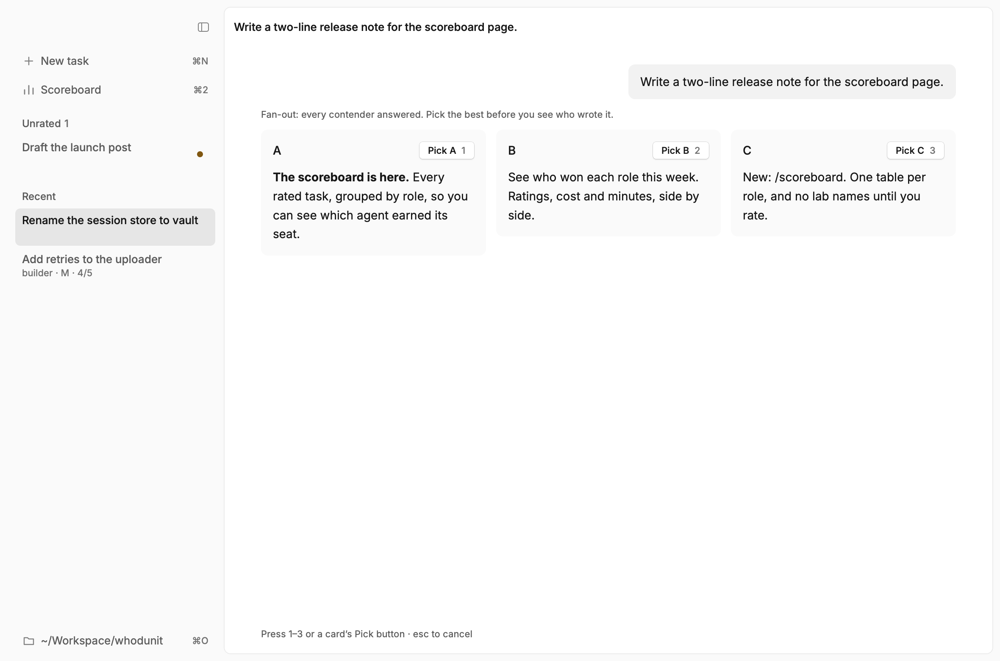

# Whodunit.app

A macOS desktop frontend for the [whodunit](../README.md) pi extension, written in Rust on [rune](https://github.com/anomalyco/rune). It drives pi over RPC (`pi --mode rpc --model whodunit/auto`) and keeps the same ground rule: neither the role nor the model shows until the run ends.

On top of plain pi it adds parallel task chats, a sidebar of sessions, a scoreboard page and a menu bar icon that reopens the window.

## Multiple tasks

One task belongs to one chat, but you can work on several tasks at once. ⌘N starts another chat without stopping the others or asking you to score them. Each live chat has its own pi process, folder, transcript, queue and dialogs. Switching back restores that chat, including any unsent draft. Chats in the same folder share files; use separate worktrees if the tasks need isolated edits.

The sidebar lists chats from every folder in three groups:

- **Working**: the agent is running, classifying or dealing, running a fan-out, or doing shell work or compaction. Background chats show their activity too.
- **Idle**: the chat is open but isn't working. It may be waiting for your reply, a role or fan-out pick, or a score. A dot marks chats waiting on a dialog. Saved open chats from earlier launches also appear here.
- **Ended**: you've scored the run and sealed the chat.

Each row shows its folder, with the role, size and score added only after the run ends. Opening a saved chat starts pi in that chat's folder; live chats keep their existing process. Changing folders starts a new chat and leaves other tasks running. Quit the app to stop all its pi processes; chats resume from their saved history, not mid-turn.

Code snippets have a **Copy** button that copies just the code, without Markdown fences. It works in chat and fan-out answers, including while an answer streams. You can still select and copy part of an answer.

Edits and writes show as diffs. While the agent works, a line over the composer says what it's doing and for how long. Thinking stays hidden until the run ends, since a trace's style names the lab; after that every thought shows in full, capped at twelve lines that scroll.

## Install

It needs macOS or Linux, and Rust (the version is pinned in `rust-toolchain.toml`). Set up the extension first, as in the [root README](../README.md#setup).

```sh
cd app
scripts/bundle.sh    # installs ~/Applications/Whodunit.app (macOS) or ~/.local/bin + a desktop entry (Linux)
```

Launched from Finder, the app runs your login shell once to find `pi` and your API keys. They stay in memory and are never written to disk.

## Ending a run

⌘D or the **End run** button opens the score card. A digit from 5 to 1 only highlights a row, and ⏎ commits, because ending can't be undone. Esc goes back to working. Once ended, the composer gives way to a **New task** button (⌘N).

<picture>
  <source media="(prefers-color-scheme: dark)" srcset="../docs/end-dark.png">
  
</picture>

End each run when you're finished with its task, not when you switch chats. ⌘D scores only the selected chat. Switching away leaves an open run unrated until you return and score it; ending one chat doesn't affect the others.

## Fan-outs

A fan-out shows each contender's answer as A, B, C. Press a letter (or 1, 2, 3) to pick the best, and the winner continues the session.



## Folder picker

⌘O, or the folder button on a new task's composer, opens the folder picker.

The top list is recent folders, newest first: the ones you opened here and the ones plain pi ran in. The folder pi runs in now isn't listed, since ⌘N already starts a new task there. Below the recents is the current folder's parent, so your other projects are one ↓ away.

⏎ works one level at a time. When the picker opens nothing is selected, and ⏎ runs pi in the folder it's browsing. ⏎ on a subfolder, or on Go up, opens that folder with its first subfolder selected, so ⏎ keeps going down, or Go up when it has none. Recent folders skip the step and run pi on the first ⏎.

Typing filters both lists and selects the first match. **Go up**, always the first row under Browse, opens its parent, as ⌫ or ← on an empty filter does. Hold ⌘ and the button turns into **Select ⌘⏎**: it runs pi in the folder you're browsing, whatever is selected.

## Keys

On Linux, read ⌘ as Ctrl.

| Key | Does |
|---|---|
| ⌘D | End the run |
| ⌘N | New task in another chat; other chats keep working |
| ⌘1 | Chat |
| ⌘2 | Scoreboard |
| ⌘O | Pick the folder pi runs in |
| ⌘⏎ | Queue a follow-up while the agent works |
| Tab / ⏎ | In the `/` list: complete the command / run it (commands that need an argument are completed instead) |
| Esc | Cancel the selected chat's dialog, or stop its agent |

## Command line

```sh
whodunit -- --cwd ~/some/dir    # run pi in that folder
whodunit -- --scoreboard        # print the scoreboard as Markdown and exit
```

The Scoreboard page shows the same numbers as `scoreboard/scoreboard.mjs`, laid out like character sheets: a row of model tiles, then one card per role. Each card has the role's criteria, a box per decider (Jev, picker, `/role`, fallback) filled to its share of deals, and every contender's score and win share as pips and its runs as tally marks. The sprites are JSON in `assets/sprites/` (16×16 roles, 12×12 models and deciders, at most 5 colors each). Roles are keyed by role name and deciders by deal source.

Model artwork in `assets/sprites/models.json` uses stable keys (`opus`, `sol`, `astra`, `gemini`, `kimi`). `assets/sprites/model-aliases.json` maps each supported `provider/model` ID to an artwork key, so multiple providers can share one sprite. To support another ID, add an explicit alias; names and ID fragments are never used to guess the icon. Unlisted IDs get `fallback`. These aliases affect only artwork, not scoreboard grouping or run history. Both files are compiled into the app, so rebuild after editing them.
