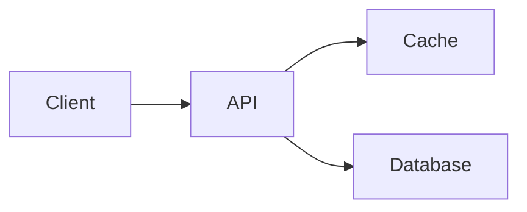

# Whodunit.app

A macOS desktop frontend for the [whodunit](../README.md) pi extension, written in Rust on [rune](https://github.com/anomalyco/rune). It drives pi over RPC (`pi --mode rpc --model whodunit/auto`) and keeps the same ground rule: neither the role nor the model shows until the run ends.

On top of plain pi it adds parallel task chats, a sidebar of sessions, a scoreboard page and a menu bar icon that reopens the window.

## Multiple tasks

You can start chatting without choosing a folder. A normal launch reconnects to the background service's live chats, or opens a **No folder** chat in its own temporary workspace when there are none. Quitting the app leaves that workspace and its work running. The service removes temporary workspaces after their chats have ended and disconnected, or when you explicitly stop the service. Chat history and scores are saved separately. Reopening a chat whose workspace was removed recreates the folder, not its files. Pick a project folder with ⌘O, or pass `--cwd`, when the work needs to stay on disk.

One task belongs to one chat, but you can work on several tasks at once. ⌘N starts another chat without stopping the others or asking you to score them. Each live chat has its own pi process, folder, transcript, queue and dialogs. Switching back restores that chat, including any unsent draft. In a folderless chat, ⌘N gives the next chat a separate temporary workspace. In a project chat, it keeps the same folder. Chats in the same folder share files; use separate worktrees if the tasks need isolated edits.

The sidebar lists chats from every folder in three groups:

- **Working**: the agent is running, classifying or dealing, running a fan-out, or doing shell work or compaction. Background chats show their activity too. While the open chat is dealt an agent, a deck of dot-art cards shuffles under the transcript and deals one off; while it works, a band of the empty state's dithered water in plain ink (black, or near-white in dark mode) rolls in from below the composer and rests just above it, clear of the chat's edges and of the composer itself. It turns a purple haze and rides higher while the agent thinks. Then it acts like a small neural net: each burst of the hidden thought fires needle spikes off the crest and lights wires through the water below, and the purple deepens as the thought runs on. Only the thought's length and a hash of its text reach the water, never the text itself. It turns red when a provider error or another failure troubles the run; the error itself shows as a toast over the composer (its message waits for `/done`, as it can name the lab). It snaps in on a stiff spring with a small overshoot, and when the turn ends it goes back out, slower than it came. While the window is unfocused, or under Reduce Motion, it simply lands where it belongs.
- **Idle**: the chat is open but isn't working. It may be waiting for your reply, a role or fan-out pick, or a score. A dot marks chats waiting on a dialog. Saved open chats from earlier launches also appear here.
- **Ended**: you've scored the run and sealed the chat. This section stays at the bottom of the sidebar and starts collapsed; click its heading to show or hide ended chats. Expanded history scrolls separately from open chats.

Each row shows its folder, with the size and score added only after the run ends. An ended row also shows its role's icon before the title and its agent's icon at the end; rest the pointer on either to see its name. Opening a saved chat starts pi in that chat's folder; live chats reconnect to their existing process. Changing folders starts a new chat and leaves other tasks running. **Quitting or crashing the app does not stop work.** The background service owns each pi process and keeps reading its output with no window connected. Reopening restores live chats, including partial answers, queued messages, fan-out progress and unanswered dialogs. An explicit `--cwd` opens a new chat in that folder while reconnecting the others.

If classification or dealing stalls, click **Stop dealing** in the composer's send slot or press Esc. The app stops that chat's pi process and restores the first prompt and its images to the composer for editing or retry. Any unsent draft stays with them, and other chats keep working. Once an agent has been dealt, Stop aborts its turn without changing the agent.

Click the conversation title, or the selected chat in the sidebar, to rename it in place. Press ⏎ or click outside to save; Esc discards the edit. An empty title keeps the old name. Titles are saved with the chat, including ended chats. Renaming doesn't send a prompt or change an unsent draft. `/name <title>` also works in open chats.

Code snippets have a copy icon that copies just the code, without Markdown fences. It changes to a checkmark briefly after copying. It works in chat and fan-out answers, including while an answer streams. You can still select and copy part of an answer.

Edits and writes show as diffs. Dot art carries the working state; a status line over the composer appears only for dealing, fan-out progress, retries and compaction. Thinking stays out of the transcript until the run ends, since a trace's style names the lab. The purple tide is the only thinking indicator; there are no redacted placeholder blocks. After the run ends every thought shows in full down a dotted rail, capped at twelve lines that scroll.

The ring next to Send shows how close the chat is to compaction. At 100%, pi compacts on its own: that's the model's window minus `compaction.reserveTokens` from pi's settings (the `whodunit/auto` override wins if you set one). It updates after every response and every batch of tool results, not only when the turn ends. Right after a compaction, pi has no count until the next response, so the ring shows the compaction's own estimate of what it kept, marked `~`. With auto-compaction off, it shows the share of the whole window.

## Background service

The app starts one local service per HOME on demand. It uses the same executable, with no separate install or launch-at-login job. The app talks to it over a Unix socket in a private, user-owned directory under `/tmp`; it does not listen on a network port. API keys stay in process memory, not in service files.

Quit closes the UI connection only. Agents can keep editing files and making paid model calls while the app is closed. Use **Stop** or Esc in a chat to abort that chat. To stop the service and all its pi processes explicitly:

```sh
# Development build
app/target/release/whodunit --service-stop

# Installed macOS app
~/Applications/Whodunit.app/Contents/MacOS/whodunit --service-stop

# Installed Linux app
whodunit --service-stop
```

The next app launch starts a new service. This protects work from UI exits and crashes, not from a pi crash, a service crash, logout or reboot. After those, open the saved chat to continue from its history; the app never automatically resends an interrupted prompt. Unsent composer drafts still belong to the UI and do not survive quitting.

The service keeps the code it started with. After updating the app, let running tasks finish and stop the service to use the new build. Ended chats with saved history are released within a minute after their clients disconnect; open, unscored chats stay available for reconnection.

Offline service tests use the built executable and a fake pi peer, with no model calls:

```sh
cd app
cargo test --test background_service
```

## Flowcharts and design systems

Chat and fan-out answers render fenced `mermaid` blocks as native diagrams. Flowcharts can show processes or system architecture; sequence, state, class, ER and C4 diagrams work too. No browser, Mermaid CLI or network service is needed. Diagrams grow as complete lines arrive in a streaming reply.

````markdown

````

The code-brackets icon (**Show source**) switches a diagram to its Mermaid text; the eye icon (**Show preview**) switches back. The copy icon copies the source without the fences and briefly becomes a checkmark. Each icon has a tooltip and an accessible label. The renderer supports a subset of Mermaid: unknown diagram types stay as code, and unsupported statements in a recognized diagram may be skipped. Check Source when a diagram looks incomplete.

For a design-token specimen, ask the agent for a fenced `design-system` block containing JSON:

````markdown
```design-system
{
  "name": "Field notes",
  "colors": {
    "ink": "#29352E",
    "paper": "#F4F1E8",
    "accent": "#B65D3C"
  },
  "typography": {
    "body": {"size": 14, "sample": "A quiet place to keep your thoughts."},
    "heading": {"size": 26, "weight": 600, "sample": "Notes from the field"}
  },
  "spacing": {"small": 8, "medium": 16, "large": 32}
}
```
````

The preview shows labeled color swatches, type samples in the app's typeface and spacing bars at their actual sizes. It has the same Source/Preview and Copy controls. This is a token preview, not an HTML/CSS playground or a component renderer.

`name` is optional, as are the three sections, but at least one section must contain tokens. Colors accept `#RGB`, `#RRGGBB` and `#RRGGBBAA`. Typography uses sizes of 8–72 points and weights of 100–900 (400 by default); `sample` is optional and limited to 160 characters. Spacing is 0–128 points. Names are at most 80 characters, each section has at most 32 tokens, and the JSON must fit in 32 KiB. Unknown fields or invalid values leave the code visible with an error. An unfinished block stays as code until its closing fence arrives. Nothing in a preview executes code or loads external fonts.

Headless fixture scenes are `flowchart` and `design-system`:

```sh
cargo run --release -- --snap flowchart.png --scene flowchart --theme dark --scale 2
cargo run --release -- --snap tokens.png --scene design-system --theme light --scale 2
```

## Images

Paste an image with ⌘V, or drop PNG, JPEG, GIF or WebP files anywhere on an open chat. They show as tiles above the composer and go with your next message. × or ⌫ in an empty composer removes one. Click any image, in the composer or the chat, to see it whole; Esc or a click closes it, and **Open in Preview** opens it to zoom. Slash and `!` commands leave them for the next prompt. pi scales large images down before a model sees them.

Jev can't see images, so it classifies the text plus a note saying images are attached. The titler sees them. In a fan-out every contender gets the images, and the winner keeps them for follow-ups. A contender without vision gets pi's placeholder text instead, so an image-heavy task can handicap it.

## Install

Set up pi and the extension first, as in the [root README](../README.md#setup).

On macOS 12 or newer, download the universal ZIP from [GitHub Releases](https://github.com/vaporwavie/whodunit/releases/latest). Unzip it and move `Whodunit.app` to `~/Applications` or `/Applications` before opening it. The same app runs on Apple Silicon and Intel.

Release builds check for updates automatically. **Check for Updates…** in the app's menu bar icon checks immediately. You confirm installation and relaunch; Sparkle downloads a signed delta patch when available, with a full-download fallback. Existing source installs need one initial release download to opt in. The background service keeps its current build until you stop it after its work finishes; an update never calls `--service-stop` for you.

To build from source on macOS or Linux, install Rust (pinned in `rust-toolchain.toml`) and Python 3.9 or newer:

```sh
cd app
scripts/bundle.sh    # installs ~/Applications/Whodunit.app (macOS) or ~/.local/bin + a desktop entry (Linux)
```

Source builds do not check for public updates. Linux currently uses this source-install path and has no OTA updater. Release signing, GitHub setup and local updater tests are documented in [releases.md](../docs/releases.md).

Launched from Finder, the background service runs your login shell once to find `pi` and your API keys. They stay in memory and are never written to disk. Restart the service after changing that environment.

## Ending a run

⌘⏎ or **I am done** below the composer opens the confirmation card. Both prompts ask **Call it done?** and keep the score blind: press 5 to 1 to highlight a score, then ⏎ or **I am done** to confirm. **Keep working** or Esc cancels without ending the run.

Once pi confirms the run is sealed, a dither sweep travels from bottom to top. **Done & dusted.** replaces the composer, with a **New task** button (⌘N). The sweep pauses while the window is unfocused and is skipped with Reduce Motion. Opening an already-ended chat doesn't replay it.

<picture>
  <source media="(prefers-color-scheme: dark)" srcset="../docs/end-dark.png">
  
</picture>

End each run when you're finished with its task, not when you switch chats. ⌘⏎ scores only the selected chat. Switching away leaves an open run unrated until you return and score it; ending one chat doesn't affect the others.

## Fan-outs

While the contenders work, each gets a slim progress lane: its data bus streams while it answers, locks in when it's done, and breaks into static if it fails. Once the answers arrive, read one at a time in the full chat column. The A, B, C buttons stay below the answer, alongside **Pick A** (or whichever answer you're viewing).

Click a letter, press A/B/C or 1/2/3, or use ←/→ to switch answers without choosing a winner. Each answer opens at the top. Press ⏎ or click **Pick** to choose the answer on screen; Esc cancels. The winner continues the session, but identities stay hidden until you end the run. In chat history, the picked answer shows first and the other answers remain browsable.

<picture>
  <source media="(prefers-color-scheme: dark)" srcset="../docs/fanout-dark.png">
  
</picture>

## Folder picker

⌘O, or the folder button on a new task's composer, opens the folder picker. Click **×** beside the selected folder to return to **No folder** in a fresh temporary workspace. Your unsent text and attachments stay in the composer; other chats keep working.

The top list is recent folders, newest first: the ones you opened here and the ones plain pi ran in. The folder pi runs in now isn't listed, since ⌘N already starts a new task there. Below the recents is the current folder's parent, so your other projects are one ↓ away. From a folderless chat, browsing starts at your home folder. Temporary workspaces don't appear in recents.

⏎ works one level at a time. When the picker opens nothing is selected, and ⏎ runs pi in the folder it's browsing. ⏎ on a subfolder, or on Go up, opens that folder with nothing selected again, so ⏎ or **Open** runs pi there; a subfolder is selected only once ↑↓, a filter or the pointer picks one, and a row the pointer picked lets go when the pointer leaves the list. Recent folders skip the step and run pi on the first ⏎.

Typing filters both lists and selects the first match. **Go up**, always the first row under Browse, opens its parent, as ⌫ or ← on an empty filter does. Hold ⌘ and the button turns into **Select ⌘⏎**: it runs pi in the folder you're browsing, whatever is selected.

## Keys

On Linux, read ⌘ as Ctrl.

| Key | Does |
|---|---|
| ⌘⏎ | Open the end-run confirmation and score card |
| ⌘N | New task in another chat; other chats keep working |
| ⌘⇧[ / ⌘⇧] | Previous / next session in sidebar order, across all groups; wraps at either end and scrolls the selected row into view. Closed Ended history opens temporarily, then closes when you cycle out |
| ⌘1 | Chat |
| ⌘2 | Scoreboard |
| ⌘O | Pick the folder pi runs in |
| ⌘I | Focus the composer (or the open dialog's field) |
| ⌘⇧⏎ | Queue a follow-up while the agent works |
| ⌘V | Paste text, or attach a copied image or image files |
| ⌫ | In an empty composer: remove the last attached image |
| Tab / ⏎ | In the `/` list: complete the command / run it (commands that need an argument are completed instead) |
| Esc | Cancel the selected chat's dialog, stop dealing and restore the prompt, or stop its agent |

## Command line

```sh
whodunit                       # reconnect, or chat in a temporary workspace
whodunit -- --cwd ~/some/dir    # run pi in that folder
whodunit -- --scoreboard        # print the scoreboard as Markdown and exit
```

The Scoreboard page shows the same numbers as `scoreboard/scoreboard.mjs`, laid out like character sheets. It opens with **Leading each role**, one tile per role with the agent winning it, its score or fan-out record and its lead over the runner-up; a role shows *No leader yet* until an agent has 3 runs. Below that come the model tiles, then one card per role, stacked in a single column so each figure column lines up down the page. A card's header has the role's sprite, its criteria and a dithered bar of who decided its deals (Jev, picker, `/role`, fallback), with each share that isn't zero beside it under its decider's icon. Under it, a table lists every contender: rank, score (and fan-outs won, which fan-out roles rank by), runs, nailed %, cost per run and your median minutes, each header explaining itself on hover. The leader's row is tinted, with its lead over the runner-up under its ranking figure. Agents short of 3 runs stay in the table, faded and unranked, but their figures are blocked: a hatch covers the columns, with a block per run needed, filled for each run done, and how many runs are left. A class without a leader still shows who is closest. The sprites are JSON in `assets/sprites/` (16×16 roles, 12×12 models and deciders, at most 5 colors each). Roles are keyed by role name and deciders by deal source.

Model artwork in `assets/sprites/models.json` uses stable keys (`opus`, `sol`, `astra`, `gemini`, `kimi`). `assets/sprites/model-aliases.json` maps each supported `provider/model` ID to an artwork key, so multiple providers can share one sprite. To support another ID, add an explicit alias; names and ID fragments are never used to guess the icon. Unlisted IDs get `fallback`. These aliases affect only artwork, not scoreboard grouping or run history. Both files are compiled into the app, so rebuild after editing them.
